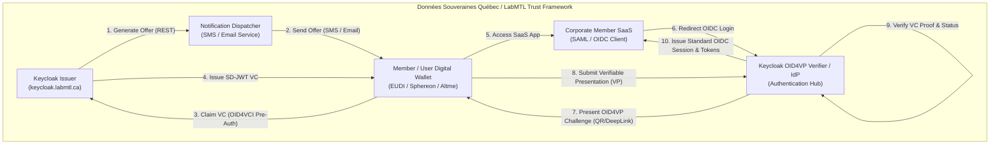
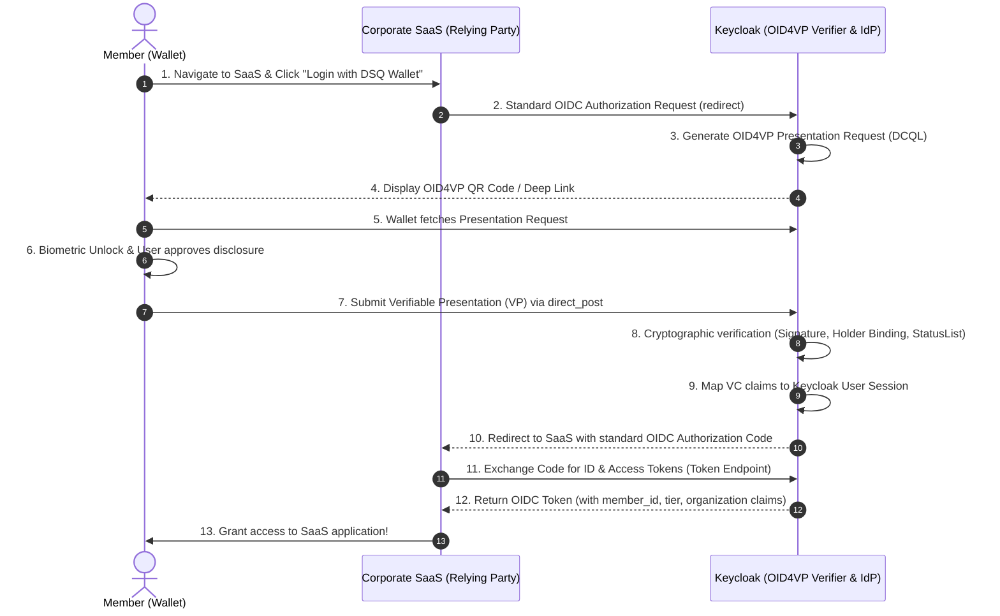

# Architecture & Design: Verifiable Membership Credentials via OID4VC & OID4VP

**Project:** Keycloak Verifiable Credential Ecosystem  
**Target Entities:** Pilot on [labmtl.ca](https://labmtl.ca) $\rightarrow$ Production on [Données Souveraines Québec](https://www.donneessouveraines.quebec/)  
**Document:** System Design & Implementation Specification (`DESIGN.md`)  
**Status:** Draft / Proposed  
**Protocols:** OpenID for Verifiable Credential Issuance (OID4VCI), OpenID for Verifiable Presentations (OID4VP), SD-JWT VC (`dc+sd-jwt`), OAuth 2.0 / OIDC  

---

## 1. Executive Summary

This document specifies the end-to-end design for issuing and verifying digital **Organization Membership Verifiable Credentials (VCs)**. 

### Core Objectives
1. **Verifiable Credential Issuance (OID4VCI)**: Leverage Keycloak (`keycloak.labmtl.ca`, migrating to `keycloak.donneessouveraines.quebec`) to issue cryptographically signed, tamper-evident membership credentials to digital wallets.
2. **Dual-Channel Offer Delivery (SMS & Email)**: Deliver credential offers directly to users via SMS or Email using deep links and QR codes powered by the **OID4VCI Pre-Authorized Code Flow**.
3. **Universal SaaS Authentication (OID4VP)**: Enable members holding this credential to log in seamlessly into any Software-as-a-Service (SaaS) application offered by participating corporate members of Données Souveraines Québec, using Keycloak as an OID4VP-to-OIDC authentication bridge.
4. **Data Sovereignty & Privacy by Design**: Implement **Selective Disclosure JWT (SD-JWT VC)** to comply with Quebec's *Loi 25* (Act respecting the protection of personal information in the private sector) and sovereign data principles.

---

## 2. High-Level Architecture & Trust Framework

The system implements the Self-Sovereign Identity (SSI) Trust Triangle adapted for enterprise federation:



### Roles & Responsibilities

| Actor | Entity | Responsibilities |
| :--- | :--- | :--- |
| **Issuer** | Keycloak (`keycloak.labmtl.ca`) | Manages user directory, signs credentials with ECDSA P-256 (`ES256`), exposes OID4VCI discovery & issuance endpoints, handles revocations. |
| **Notification Dispatcher** | Notification Service / Keycloak SPI | Calls Keycloak REST endpoint to generate pre-authorized offers, crafts responsive SMS and HTML emails with deep links (`openid-credential-offer://`) and QR codes. |
| **Holder** | Member's Digital Wallet | Securely stores cryptographic private keys (in Secure Enclave / StrongBox), receives VCs, selectively discloses attributes, generates presentation proofs. |
| **Verifier / Bridge** | Keycloak OID4VP Identity Provider | Requests presentations via Digital Credential Query Language (DCQL), verifies cryptographic signatures and status, bridges VC claims to standard OIDC/SAML tokens for SaaS applications. |
| **Relying Party (RP)** | Corporate Member SaaS Apps | Standard enterprise cloud apps (Nextcloud, Mattermost, GitLab, proprietary portals) that delegate authentication to Keycloak over standard OpenID Connect. |

---

## 3. Credential Data Model & Schema

### Format: Selective Disclosure JWT (SD-JWT VC)
The credential format is `dc+sd-jwt` (IETF SD-JWT VC specification), signed using `ES256` (ECDSA over NIST P-256).

### Configuration Identifier
- **Pilot ID**: `LabMtlMembershipCredential`
- **Production ID**: `DSQMembershipCredential`
- **Type**: `["VerifiableCredential", "OrganizationMembershipCredential"]`

### Credential Attributes & Selective Disclosure Flags

| Attribute | Type | SD? | Description | Example |
| :--- | :--- | :---: | :--- | :--- |
| `iss` | String (URI) | No | Issuer realm URI | `https://keycloak.labmtl.ca/realms/ssi-realm` |
| `sub` | String | No | Unique persistent subject identifier | `usr_01J98ABCDEF12345` |
| `iat` | Integer | No | Issuance timestamp (UNIX) | `1792843200` |
| `exp` | Integer | No | Expiration timestamp (e.g. 1 year) | `1824379200` |
| `cnf` | Object | No | Confirmation key (Holder public key thumbprint) | `{"jwk": {...}}` |
| `status` | Object | No | Revocation status list reference | `{"status_list": {...}}` |
| `member_id` | String | **Yes** | Official member identifier | `DSQ-MEM-2026-042` |
| `organization_name` | String | **Yes** | Issuing organization | `Données Souveraines Québec` |
| `organization_id` | String | **Yes** | Quebec Business Number (NEQ) / Org ID | `NEQ 1178923456` |
| `member_company` | String | **Yes** | Name of corporate member company | `Cohabitat Inc.` |
| `member_company_neq` | String | **Yes** | NEQ of corporate member | `NEQ 1170098765` |
| `member_tier` | String | **Yes** | Role / Membership level | `corporate_admin` / `technical_delegate` / `standard_member` |
| `given_name` | String | **Yes** | First name of the member | `Alexandre` |
| `family_name` | String | **Yes** | Last name of the member | `Tremblay` |
| `email` | String | **Yes** | Official corporate email | `alexandre.tremblay@cohabitat.cc` |
| `phone_number` | String | **Yes** | Mobile phone number | `+15145550199` |

> [!NOTE]
> **Selective Disclosure (SD)** allows the member to prove they possess an active `corporate_admin` membership in *Données Souveraines Québec* without necessarily revealing their personal phone number or email if the target SaaS only requires membership tier authorization.

---

## 4. Credential Issuance Architecture (OID4VCI)

### 4.1 Required Keycloak Feature Flags
Keycloak must be run with the following preview/experimental flags enabled:
```bash
--features=oid4vc-vci,oid4vc-vci-rest-credential-offer,oid4vc-vci-preauth-code,oid4vc-vp
```

### 4.2 REST Credential Offer Creation
The Notification Dispatcher requests a credential offer from Keycloak via the REST endpoint:
```http
GET /realms/{realm}/protocol/oid4vc/create-credential-offer
    ?credential_configuration_id=DSQMembershipCredential
    &target_user={userId_or_username}
    &pre_authorized=true
    &tx_code=true
    &expire=86400
    &type=uri
```

#### Key Parameters:
1. `credential_configuration_id`: Identifies the client scope configuration (`DSQMembershipCredential` / `VerifiableIdentity`).
2. `target_user`: Binds the pre-authorized code to the specific user account in Keycloak.
3. `pre_authorized=true`: Enables the Pre-Authorized Code Grant flow (no interactive web login required during wallet claiming).
4. `tx_code=true`: Requires a one-time transaction PIN (e.g. 6 digits) when the wallet redeems the code, ensuring high security.
5. `expire=86400`: The offer link expires in 24 hours.

#### Keycloak Response:
Keycloak returns a standard OID4VCI Credential Offer URI:
```text
openid-credential-offer://?credential_offer_uri=https%3A%2F%2Fkeycloak.labmtl.ca%2Frealms%2Fssi-realm%2Fprotocol%2Foid4vc%2Fcredential-offer%2F3f9b87c2-1a4e-4f7b-a2c3
```

---

## 5. Dual-Channel Delivery: SMS & Email

To ensure maximum accessibility, the credential offer is dispatched using either SMS, Email, or both.

```
       +-------------------------------------------------------+
       |             Keycloak User Directory                   |
       |  Attributes: email, phone_number, member_tier, etc.  |
       +-------------------------------------------------------+
                                  |
                                  v
       +-------------------------------------------------------+
       |             Notification Dispatcher                   |
       |  (REST Client / Keycloak Event Listener / Admin CLI)  |
       +-------------------------------------------------------+
                       /                       \
                      /                         \
                     v                           v
         +-----------------------+   +-----------------------+
         |     SMS Gateway       |   |      SMTP / SES       |
         |  (Twilio / Telnyx)    |   |  (Postmark / Mailgun) |
         +-----------------------+   +-----------------------+
                     |                           |
                     v                           v
           [ SMS to Mobile ]            [ HTML Email with QR ]
                     \                           /
                      \                         /
                       v                       v
         +-------------------------------------------------------+
         |               Universal Claim Portal                  |
         |      https://keycloak.labmtl.ca/claim?offer=...       |
         |                                                       |
         | - Mobile browser: Auto-redirects to wallet app        |
         | - Desktop browser: Displays QR Code + Wallet download |
         +-------------------------------------------------------+
```

### 5.1 SMS Delivery Specification
* **Target**: User's verified `phone_number` attribute in Keycloak.
* **Payload**: Concise SMS message with a branded short-link:
  ```text
  [Données Souveraines Québec]
  Votre titre d'adhésion numérique est prêt.
  Cliquez pour l'ajouter à votre portefeuille : 
  https://keycloak.labmtl.ca/claim?id=3f9b87c2
  Code de sécurité (NIP) : 842109
  ```
* **Handling**:
  * Tapping the link on a smartphone triggers the Universal Link / custom URL scheme (`openid-credential-offer://...`), directly launching the user's digital wallet.
  * If the wallet is not yet installed, the landing page guides the user to install a compatible wallet (e.g., Sphereon, Altme, or Quebec/EUDI reference wallet).

### 5.2 Email Delivery Specification
* **Target**: User's verified `email` attribute.
* **Payload**: Responsive HTML email featuring:
  1. **Branded Header**: Données Souveraines Québec / LabMTL logo and seal.
  2. **Cross-Device Flow (QR Code)**: High-resolution QR code embedding the credential offer URI for users reading email on a desktop computer who wish to scan with their mobile phone wallet.
  3. **Same-Device Flow (Button)**: "Ajouter à mon portefeuille / Add to Wallet" button linked directly to `openid-credential-offer://...`.
  4. **Security Notice & Transaction PIN (`tx_code`)**: Explicitly displays the required 6-digit PIN needed to unlock the credential.
  5. **Expiration Warning**: Informs user the offer expires within 24 hours.

### 5.3 Security Hardening: Out-of-Band (OOB) PIN
For maximum assurance:
- The **Credential Offer Link** can be sent via **Email**.
- The **Transaction Code (`tx_code`)** can be sent via **SMS** to the user's mobile phone.
This guarantees that a compromised email account alone cannot result in credential theft.

---

## 6. SaaS Authentication Architecture (OID4VP)

Participating corporate members offer diverse SaaS platforms (e.g. Cloud storage, internal wikis, CRM, analytics dashboards). To avoid requiring every SaaS application to implement complex cryptographic Verifiable Presentation libraries, **Keycloak acts as the Central OID4VP Verifier & Identity Broker**.

### 6.1 Authentication Protocol Flow



### 6.2 Digital Credential Query Language (DCQL) Query
Keycloak generates an OID4VP request specifying the exact requirements:
```json
{
  "queries": [
    {
      "id": "membership_query",
      "format": "dc+sd-jwt",
      "meta": {
        "vct_values": ["https://keycloak.labmtl.ca/credentials/v1/membership"]
      },
      "claims": [
        {"path": ["member_id"]},
        {"path": ["organization_name"]},
        {"path": ["member_tier"]},
        {"path": ["email"]}
      ]
    }
  ]
}
```

### 6.3 SaaS Integration Simplicity
Because Keycloak translates the Verifiable Presentation into standard **OpenID Connect ID Tokens**, corporate member SaaS applications only need a standard OIDC client configuration:
* **Client ID**: `corporate-saas-app`
* **Redirect URI**: `https://saas.membercompany.ca/oauth/callback`
* **Scopes**: `openid profile email dsq_membership`
* **Token Claims received by SaaS**:
  ```json
  {
    "sub": "DSQ-MEM-2026-042",
    "email": "alexandre.tremblay@cohabitat.cc",
    "organization": "Données Souveraines Québec",
    "member_company": "Cohabitat Inc.",
    "member_tier": "corporate_admin",
    "membership_status": "active"
  }
  ```

---

## 7. Lifecycle & Revocation Management

Verifiable credentials must reflect real-time membership standing (e.g. employee departure or organization status changes).

### 7.1 Revocation Mechanism: Token Status List
1. Keycloak hosts a cryptographically signed **Token Status List (Bitstring / IETF draft-ietf-oauth-status-list)**.
2. The credential's `status` claim points to the status list URI on `keycloak.labmtl.ca`.
3. When a member's status is revoked in Keycloak Admin, the corresponding bit in the status list is updated to `1` (revoked).
4. During OID4VP login, the Keycloak verifier checks the status list; revoked credentials are immediately rejected.

### 7.2 Credential Renewal & Expiration
* Credential validity is set to **12 months** (`exp` claim).
* 30 days before expiration, Keycloak triggers an automated renewal notification (SMS/Email) issuing an updated credential offer.

---

## 8. Implementation & Deployment Plan

### Phase 1: Prototype on `keycloak.labmtl.ca` (Immediate)
- [x] Keycloak container running with OID4VCI flags (`run-keycloak.sh`).
- [ ] Add `oid4vc-vp` feature flag to enable OID4VP verifier capabilities.
- [ ] Update `ssi-realm.json` with `DSQMembershipCredential` scope, claims mapping, and ECDSA P-256 keys.
- [ ] Build the lightweight `oid4vc-notifier` script / daemon (Python/Node.js) to trigger `create-credential-offer` and dispatch SMS (Twilio/AWS SNS) and Email (SMTP/Postmark).
- [ ] Test claiming with standard mobile wallets (Sphereon Wallet, Altme, Lissi ID Wallet).
- [ ] Configure sample OIDC client in Keycloak to demonstrate end-to-end login with the wallet.

### Phase 2: Pilot with LabMTL Partner Projects
- [ ] Integrate login for community platforms: `cohabitat.cc`, `labcitoyen.org`, `coderbunker.ca`.
- [ ] Gather UX feedback regarding the QR code scanning vs. SMS link claiming experience.

### Phase 3: Production Rollout for `donneessouveraines.quebec`
- [ ] Set up dedicated production Keycloak cluster at sovereign Canadian datacenters (e.g. OVHcloud Beauharnois, Quebec).
- [ ] Configure production domain `keycloak.donneessouveraines.quebec` with official DNSSEC and EV/TLS certificates.
- [ ] Publish official DID Document and Federation Trust Registry.
- [ ] Provide turnkey OIDC onboarding documentation for corporate member SaaS engineering teams.

---

## 9. Appendix: Configuration References

### 9.1 Keycloak Startup Command
Updated `run-keycloak.sh` startup parameters:
```bash
docker run --rm \
    --name keycloak-ssi \
    -p 127.0.0.1:8080:8080 \
    -e KC_BOOTSTRAP_ADMIN_USERNAME=admin \
    -e KC_BOOTSTRAP_ADMIN_PASSWORD=ThermoFlask2026 \
    quay.io/keycloak/keycloak:latest \
    start-dev --proxy-headers xforwarded \
              --features=oid4vc-vci,oid4vc-vci-rest-credential-offer,oid4vc-vci-preauth-code,oid4vc-vp
```

### 9.2 Keycloak Credential Scope Definition (`ssi-realm.json` update)
```json
{
  "name": "OrganizationMembership",
  "protocol": "oid4vc",
  "attributes": {
    "vc.format": "dc+sd-jwt",
    "vc.credential_configuration_id": "DSQMembershipCredential",
    "vc.proof_signing_alg_values_supported": "ES256",
    "vc.vct": "https://keycloak.labmtl.ca/credentials/v1/membership"
  },
  "protocolMappers": [
    {
      "name": "member-id-mapper",
      "protocol": "oid4vc",
      "protocolMapper": "oid4vc-user-attribute-mapper",
      "config": {
        "user.attribute": "member_id",
        "claim.name": "member_id",
        "selective.disclosure": "true"
      }
    },
    {
      "name": "organization-name-mapper",
      "protocol": "oid4vc",
      "protocolMapper": "oid4vc-user-attribute-mapper",
      "config": {
        "user.attribute": "organization_name",
        "claim.name": "organization_name",
        "selective.disclosure": "true"
      }
    },
    {
      "name": "member-tier-mapper",
      "protocol": "oid4vc",
      "protocolMapper": "oid4vc-user-attribute-mapper",
      "config": {
        "user.attribute": "member_tier",
        "claim.name": "member_tier",
        "selective.disclosure": "true"
      }
    },
    {
      "name": "email-mapper",
      "protocol": "oid4vc",
      "protocolMapper": "oid4vc-user-attribute-mapper",
      "config": {
        "user.attribute": "email",
        "claim.name": "email",
        "selective.disclosure": "true"
      }
    }
  ]
}
```
